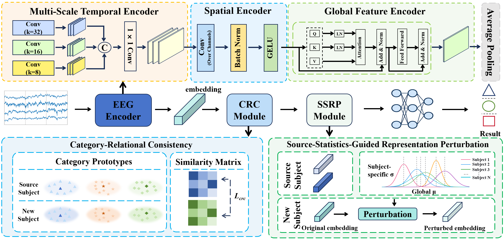

# CRDA

## Model Architecture

The overall architecture of CRDA is illustrated below.



## Main Dependencies

- CUDA 12.2
- PyTorch 2.7.0
- Python 3.12

## Train

Run the following command to train the model:

```bash
python train.py
```
